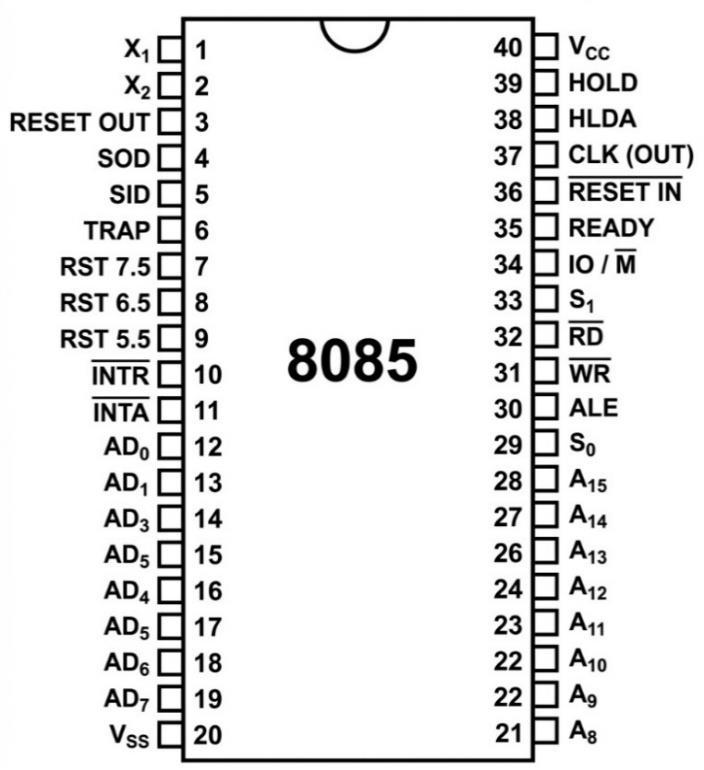

# Practical 01 — Study of 8085 Microprocessor & 8051 Microcontroller

> **Aim:** Study the architecture, pin configurations, and key differences between the Intel 8085 microprocessor and the Intel 8051 microcontroller.  
> **Apparatus:** 8085 and 8051 trainer kits *(theory practical — no code required)*.

---

## Pin Diagrams

### Intel 8085 Microprocessor (40-Pin DIP)

### Intel 8051 Microcontroller (40-Pin DIP)

---

## Write-Up & Key Components

### Intel 8085 Microprocessor
An 8-bit general-purpose CPU that requires external RAM, ROM, and I/O peripherals to form a complete system.

- **Power & Clock:** `VCC` (Pin 40, +5 V), `VSS` (Pin 20, GND), `X1`/`X2` (Pins 1–2, crystal oscillator input).
- **Buses:** Multiplexed lower address/data bus `AD0–AD7` (Pins 12–19) demultiplexed via `ALE` (Pin 30); upper address bus `A8–A15` (Pins 21–28).
- **Control & Status:** `IO/M̄` (Pin 34), `RD̄` (Pin 32), `WR̄` (Pin 31), `S0`/`S1` (Pins 29, 33), `READY` (Pin 35), `HOLD`/`HLDA` (Pins 39, 38).
- **Interrupts & Reset:** `TRAP` (Pin 6, non-maskable), `RST7.5/6.5/5.5` (Pins 7–9), `INTR`/`INTĀ` (Pins 10–11), `RESET IN̄` (Pin 36), `RESET OUT` (Pin 3).
- **Serial I/O:** `SID` (Pin 5) and `SOD` (Pin 4).

### Intel 8051 Microcontroller
An 8-bit single-chip embedded controller with on-chip CPU, RAM, ROM, timers, UART, and four bidirectional I/O ports.

- **Power, Clock & Reset:** `VCC` (Pin 40, +5 V), `GND` (Pin 20), `XTAL1`/`XTAL2` (Pins 19, 18), active-high `RST` (Pin 9).
- **I/O Ports (32 pins total):**
  - **Port 0 (`P0.0–P0.7`, Pins 39–32):** Open-drain I/O (needs external 10 kΩ pull-ups) or multiplexed `AD0–AD7`.
  - **Port 1 (`P1.0–P1.7`, Pins 1–8):** General-purpose bidirectional I/O with internal pull-ups.
  - **Port 2 (`P2.0–P2.7`, Pins 21–28):** General-purpose I/O with internal pull-ups or upper address bus `A8–A15`.
  - **Port 3 (`P3.0–P3.7`, Pins 10–17):** I/O plus alternate functions (`RXD`, `TXD`, `INT0̄`, `INT1̄`, `T0`, `T1`, `WR̄`, `RD̄`).
- **External Memory Control:** `EĀ` (Pin 31 — tie high for internal ROM), `ALE` (Pin 30), `PSEN̄` (Pin 29).

### Microprocessor vs. Microcontroller

| Feature | Microprocessor (8085) | Microcontroller (8051) |
| :--- | :--- | :--- |
| Integration | CPU only; external RAM, ROM, I/O needed | CPU, RAM, ROM, timers, and I/O on one chip |
| Architecture | Typically Von Neumann | Typically Harvard |
| Typical Use | General-purpose computing | Dedicated embedded control |
| Hardware Complexity & Power | Higher external circuitry and power draw | Compact, low power, lower cost |
| Bit Addressability | Generally not supported | Supported (SFRs and bit-addressable RAM) |
