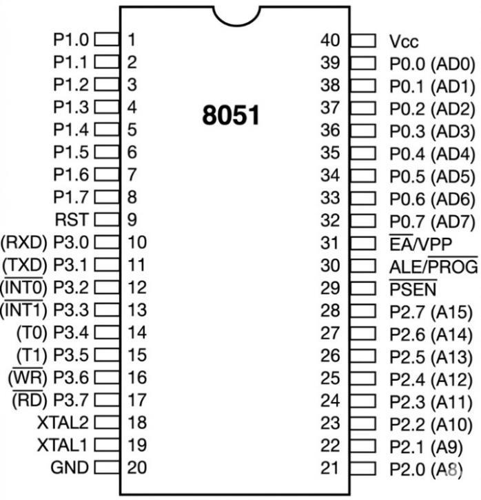

# Practical 01 — Study of 8085 Microprocessor & 8051 Microcontroller

## Pin Diagrams

### 8085 Microprocessor Pin Diagram

### 8051 Microcontroller Pin Diagram

---

## Write-Up

**Aim:** To study the Microprocessor (8085) and Microcontroller (8051).

**Apparatus:** Trainer kit of 8051 and 8085.

### Theory
A microprocessor (8085) contains only a CPU requiring external memory and I/O, whereas a microcontroller (8051) integrates CPU, RAM, ROM, timers, and I/O ports on one chip for embedded control.

### Key Pin Summary
- **8085 (40-pin):** `VCC` (40), `VSS` (20), `X1/X2` (1–2), `AD0–AD7` (12–19), `A8–A15` (21–28), `ALE` (30), `WR̄` (31), `RD̄` (32), `IO/M̄` (34), `RESET IN̄` (36), interrupts `TRAP/RST/INTR` (6–10).
- **8051 (40-pin):** `VCC` (40), `GND` (20), `XTAL1/XTAL2` (19–18), `RST` (9), Ports `P0` (39–32), `P1` (1–8), `P2` (21–28), `P3` (10–17), `PSEN̄` (29), `ALE` (30), `EĀ` (31).

### Comparison

| Microprocessor (8085) | Microcontroller (8051) |
| :--- | :--- |
| Contains only CPU | CPU, RAM, ROM, I/O, and timers on a single chip |
| Von Neumann architecture (mostly) | Harvard architecture (mostly) |
| General-purpose computing; higher hardware and power | Application-specific embedded systems; compact and low power |
| Rarely bit-addressable | Supports bit-addressability |

### Conclusion
The pin configurations, architectures, and key differences between the 8085 microprocessor and 8051 microcontroller were studied successfully.

---

## Lab Kit Procedure

1. Identify the 40-pin DIP IC notch (Pin 1 is top-left, Pin 40 is top-right) on both the 8085 and 8051 trainer kits.
2. Locate the crystal oscillator, reset push button, +5 V regulated power supply, and I/O port headers on each board.
3. Map the physical pins against the pin diagrams above before connecting external peripherals.
