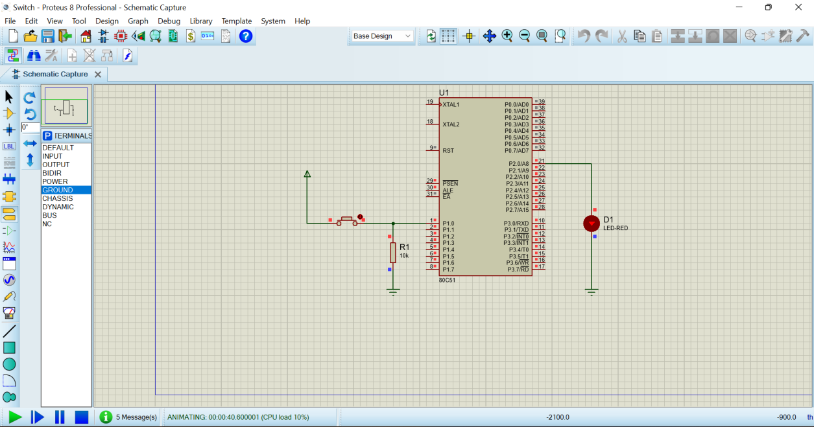

# Practical 04 — Switch Interfacing with 8051

## Code

```asm
ORG 00H
HERE:   CLR P1.0
        CLR P2.0
        JB P1.0, NEXT
        SJMP HERE
NEXT:   SETB P2.0
        JNB P1.0, HERE
        SJMP NEXT
END
```

---

## Circuit Diagram

### Proteus Simulation Circuit



### Basic Switch Concept


---

## Write-Up

**Aim:** Perform switch interfacing with 8051 microcontroller.

**Apparatus:** Keil uVision software and Proteus software.

### Theory
A switch applies logic `0` or `1` to an 8051 input pin (`P1.0`). Polling `P1.0` via `JB`/`JNB` lets the controller turn an output LED on `P2.0` ON or OFF.

### Steps
1. Set program origin at `00H` and clear `P1.0` and `P2.0` (LED OFF).
2. Poll `P1.0` using `JB P1.0, NEXT`; remain in `HERE` while the switch is open (`P1.0 = 0`).
3. When the switch closes (`P1.0 = 1`), jump to `NEXT` and execute `SETB P2.0` (LED ON).
4. Poll `P1.0` using `JNB P1.0, HERE`; hold LED ON until the switch opens (`P1.0 = 0`), then loop back to `HERE`.

### Conclusion
Switch interfacing with the 8051 microcontroller was implemented and verified using Keil uVision and Proteus.

---

## Software Operation Guide (Keil uVision & Proteus)

### 1. Keil uVision Setup (Generate `.hex`)
1. Create a folder `C:\MPMC\P04_Switch\`.
2. Open **Keil uVision** → **Project → New uVision Project** → save as `switch.uvproj` inside `C:\MPMC\P04_Switch\`.
3. Select device **Atmel / Microchip → `AT89C51`** → **OK** → click **No** for `STARTUP.A51`.
4. Click **File → New**, paste the code above, and save as `switch.asm` in the same folder.
5. Expand **Target 1** → right-click **Source Group 1 → Add Existing Files to Group 'Source Group 1'** → change **Files of type** to **`Asm Source file (*.s*; *.src; *.a*)`** → add `switch.asm` → **Close**.
6. Right-click **Target 1 → Options for Target 'Target 1' → Output** tab → tick **Create HEX File** → **OK**.
7. Press **`F7`** (Build) and verify `0 Error(s), 0 Warning(s)` and `creating hex file from ".\Objects\switch"`.
8. *(Optional Keil check)* Press **`Ctrl+F5`** → open **Peripherals → I/O-Ports → Port 1** and **Port 2** → toggle `P1.0` checkbox while running (`F5`) to observe `P2.0` follow it.

### 2. Proteus 8 Professional Setup (Components & Wiring)
1. Open **Proteus 8 Professional** → **File → New Project** → name it `Switch` → choose **Create a schematic from the selected template (DEFAULT)** → Next → Finish.
2. Open **Component Mode** *(left vertical toolbar, 2nd icon)* → click **`P`** (*Pick Devices*) and search these exact keywords:

   | Search Section | Exact Keyword | Value / Notes |
   | :--- | :--- | :--- |
   | **Component Mode (`P`)** | `80C51` *(or `AT89C51`)* | Microcontroller (`U1`) |
   | **Component Mode (`P`)** | `BUTTON` | Push-button switch |
   | **Component Mode (`P`)** | `RES` | Pull-down resistor `R1` (double-click → set `10k`) |
   | **Component Mode (`P`)** | `LED-RED` | Output LED (`D1`) |
   | **Terminals Mode** *(left toolbar)* | `POWER` | +5 V supply to one side of `BUTTON` |
   | **Terminals Mode** *(left toolbar)* | `GROUND` | Ground for `R1` bottom and `D1` cathode |

3. Wire the circuit: `POWER` → `BUTTON` → `P1.0` (Pin 1) & `R1 (10k)` → `GROUND`; `P2.0` (Pin 21) → `LED-RED` anode → `GROUND`.

### 3. Linking Keil & Proteus
1. Double-click **`U1` (`80C51`)** in Proteus to open **Edit Component**.
2. Next to **Program File**, click the folder icon and select `C:\MPMC\P04_Switch\Objects\switch.hex`.
3. Keep **Clock Frequency** at `12MHz` (or `11.0592MHz`) and click **OK**.
4. Click the green **Play** button (bottom-left). Press and hold (or latch) the push button in Proteus — `D1` (`LED-RED`) turns **ON** when closed and **OFF** when open.
