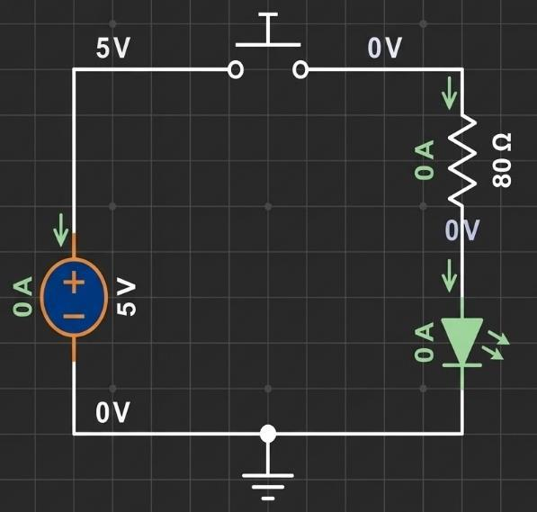

# Practical 04 — Switch Interfacing with 8051

> **Aim:** Interface a push-button switch with the 8051 microcontroller to turn an LED ON when the switch is closed and OFF when open.  
> **Apparatus:** Keil uVision IDE and Proteus.

---

## Code

```asm
ORG 0000H
HERE:   CLR P1.0            ; Ensure P1.0 starts low (pulled down externally)
        CLR P2.0            ; Turn LED OFF (P2.0 = 0)
        JB P1.0, NEXT       ; If switch is pressed (P1.0 = 1), jump to NEXT
        SJMP HERE           ; Otherwise keep LED OFF and keep polling

NEXT:   SETB P2.0           ; Turn LED ON (P2.0 = 1)
        JNB P1.0, HERE      ; If switch is released (P1.0 = 0), jump to HERE
        SJMP NEXT           ; Otherwise keep LED ON
END
```

---

## Circuit Diagram

### Proteus Simulation Circuit


### Basic Switch-LED Concept



---

## Write-Up & Components

### How It Works
The program continuously polls bit **`P1.0`** using the bit-test instructions `JB` (Jump if Bit set) and `JNB` (Jump if Bit not set).
- **Switch Open:** The 10 kΩ pull-down resistor (`R1`) holds `P1.0` at logic `0` (0 V), so the microcontroller keeps `P2.0 = 0` and the LED stays **OFF**.
- **Switch Closed:** Pressing the switch connects `P1.0` to `+5 V` (logic `1`), causing the code to jump to `NEXT` and set `P2.0 = 1`, turning the LED **ON** until the switch is released.

### Key Components & Connections

| Component | Proteus Name / Value | Connection |
| :--- | :--- | :--- |
| Microcontroller | `80C51` (`AT89C51`) | Core controller |
| Push-button Switch | `BUTTON` | Between `+5 V` (POWER) and `P1.0` (Pin 1) |
| Pull-down Resistor (`R1`) | `10kΩ` | Between `P1.0` (Pin 1) and `GND` (prevents floating input) |
| Indicator LED (`D1`) | `LED-RED` | Anode to `P2.0` (Pin 21), Cathode to `GND` *(use a 220–330 Ω series resistor on physical hardware)* |
