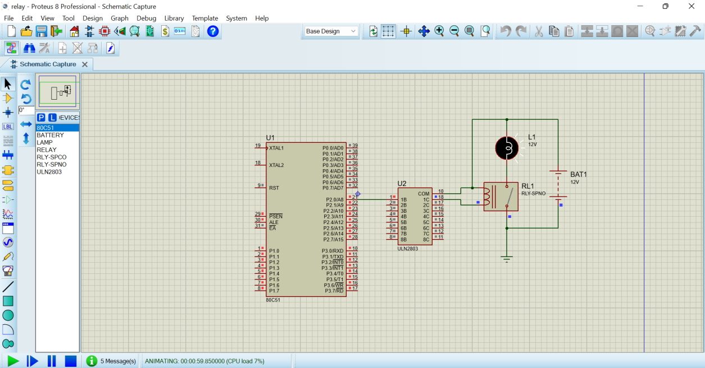

# Practical 05 — Relay Interfacing with 8051

> **Aim:** Interface an electromechanical relay with the 8051 microcontroller and toggle a 12 V load ON and OFF periodically.  
> **Apparatus:** Keil uVision IDE and Proteus.

---

## Code

```asm
ORG 0000H
MAIN:   SETB P2.0           ; Turn relay ON (P2.0 = 1)
        ACALL DELAY         ; Wait
        CLR P2.0            ; Turn relay OFF (P2.0 = 0)
        ACALL DELAY         ; Wait
        SJMP MAIN           ; Repeat indefinitely

DELAY:  MOV R3, #100        ; Triple-nested software delay
L3:     MOV R4, #255
L2:     MOV R5, #255
L1:     DJNZ R5, L1
        DJNZ R4, L2
        DJNZ R3, L3
        RET
END
```

---

## Circuit Diagram

### Proteus Simulation Circuit (ULN2803 Driver)



### Discrete Transistor Relay Driver Reference


---

## Write-Up & Components

### How It Works
An 8051 port pin cannot directly supply the current (~70 mA) or voltage (12 V) needed to energize a relay coil, and switching an inductive coil generates high-voltage **back EMF** when turned off. A driver stage solves both problems:
- **In Proteus (`ULN2803`):** `P2.0` drives input `1B` (Pin 1) of the `ULN2803` Darlington transistor array. When `P2.0 = 1`, output `1C` (Pin 18) sinks current through the relay coil (`RL1`), closing its normally-open (`SPNO`) contact and lighting the `12 V` lamp (`L1`). Built-in clamping diodes on `COM` (Pin 10) suppress back EMF.
- **Discrete Alternative (`BC547`):** An NPN transistor driven into saturation via a pull-up/base resistor switches the coil, with a `1N4148` / `1N4007` flyback diode across the coil to protect the transistor.

### Key Components & Connections

| Component | Proteus Name / Value | Role & Connection |
| :--- | :--- | :--- |
| Microcontroller | `80C51` (`AT89C51`) | Outputs control signal on `P2.0` (Pin 21) |
| Relay Driver IC (`U2`) | `ULN2803` | High-current Darlington driver + internal flyback diodes (`1B` ← `P2.0`, `1C` & `COM` → relay coil) |
| Relay (`RL1`) | `RLY-SPNO` | Electromechanical switch isolating 5 V logic from 12 V load |
| Load (`L1`) & Supply (`BAT1`) | `LAMP` (12 V), `BATTERY` (12 V) | Switched across relay contacts and ground |
