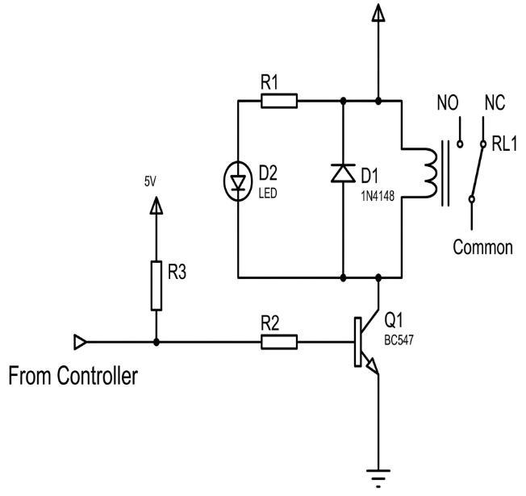

# Practical 05 — Relay Interfacing with 8051

## Code

```asm
ORG 0000H
MAIN:   SETB P2.0
        ACALL DELAY
        CLR P2.0
        ACALL DELAY
        SJMP MAIN
DELAY:  MOV R3, #100
L3:     MOV R4, #255
L2:     MOV R5, #255
L1:     DJNZ R5, L1
        DJNZ R4, L2
        DJNZ R3, L3
        RET
END
```

---

## Circuit Diagram

### Proteus Simulation Circuit (ULN2803 Driver)


### Discrete Relay Driver Reference (BC547)



---

## Write-Up

**Aim:** Interface relay with microcontroller and turn it ON and OFF.

**Apparatus:** Keil uVision software and Proteus software.

### Theory
A relay allows low-power 8051 pins to switch high-voltage loads using a driver IC (`ULN2803`) or transistor (`BC547`) with a flyback diode to absorb inductive back EMF.

### Steps
1. Set program origin at `0000H`.
2. Set `P2.0` high (`SETB P2.0`) to energize the relay coil via the driver.
3. Call `DELAY` to keep the relay ON for a visible duration.
4. Clear `P2.0` (`CLR P2.0`) to de-energize the relay and call `DELAY`.
5. Jump back to `MAIN` (`SJMP MAIN`) to toggle the relay continuously.

### Conclusion
Relay interfacing with the 8051 microcontroller was implemented to switch a 12 V lamp ON and OFF periodically in Keil uVision and Proteus.

---

## Software Operation Guide (Keil uVision & Proteus)

### 1. Keil uVision Setup (Generate `.hex`)
1. Create a folder `C:\MPMC\P05_Relay\`.
2. Open **Keil uVision** → **Project → New uVision Project** → save as `relay.uvproj` inside `C:\MPMC\P05_Relay\`.
3. Select **Atmel / Microchip → `AT89C51`** → **OK** → click **No** for `STARTUP.A51`.
4. Click **File → New**, paste the code above, and save as `relay.asm` in the same folder.
5. Expand **Target 1** → right-click **Source Group 1 → Add Existing Files to Group 'Source Group 1'** → set **Files of type** to **`Asm Source file (*.s*; *.src; *.a*)`** → add `relay.asm` → **Close**.
6. Right-click **Target 1 → Options for Target 'Target 1' → Output** tab → tick **Create HEX File** → **OK**.
7. Press **`F7`** (Build) → confirm `0 Error(s), 0 Warning(s)` and `Objects\relay.hex` created.
8. *(Optional Keil check)* Press **`Ctrl+F5`** → open **Peripherals → I/O-Ports → Port 2** → run (`F5`) and observe `P2.0` toggling.

### 2. Proteus 8 Professional Setup (Components & Wiring)
1. Create a new Proteus schematic project named `Relay`.
2. Pick components using these exact sections and keywords:

   | Search Section | Exact Keyword | Value / Notes |
   | :--- | :--- | :--- |
   | **Component Mode (`P`)** | `80C51` *(or `AT89C51`)* | Microcontroller (`U1`) |
   | **Component Mode (`P`)** | `ULN2803` | 8-channel Darlington driver (`U2`) |
   | **Component Mode (`P`)** | `RLY-SPNO` | Single-pole normally-open relay (`RL1`, set coil voltage `12V`) |
   | **Component Mode (`P`)** | `LAMP` | 12 V indicator lamp (`L1`, default `12V`) |
   | **Component Mode (`P`)** | `BATTERY` | DC supply (`BAT1`, double-click → set `12V`) |
   | **Terminals Mode** *(left toolbar)* | `GROUND` | Common ground at relay contact / battery negative |

3. Wire the circuit: `P2.0` (Pin 21) → `ULN2803` `1B` (Pin 1); `ULN2803` `COM` (Pin 10) and `1C` (Pin 18) across the `RL1` coil; connect `BAT1 (12V)` in series with `LAMP` and `RL1` switch contacts, with `COM` tied to `+12V` and negative rail to `GROUND`.

### 3. Linking Keil & Proteus
1. Double-click **`U1` (`80C51`)** → **Program File** → browse to `C:\MPMC\P05_Relay\Objects\relay.hex` → click **OK**.
2. Click the green **Play** button (bottom-left). The relay contact closes and opens periodically, turning the 12 V lamp ON and OFF.
