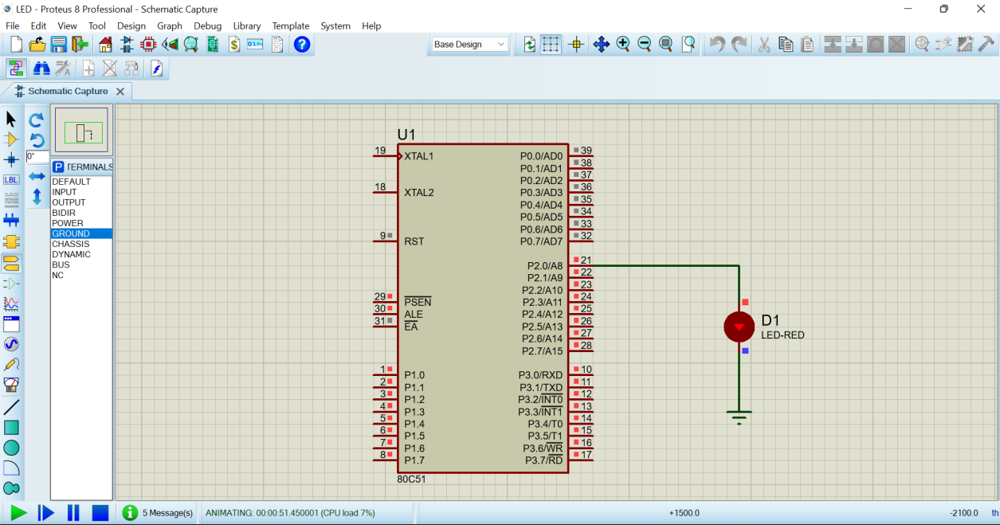

# Practical 06 — LED Blinking with 8051

## Code

```asm
ORG 0000H
UP:     SETB P2.0
        ACALL DELAY
        CLR P2.0
        ACALL DELAY
        SJMP UP
DELAY:  MOV R4, #35
H1:     MOV R3, #255
H2:     DJNZ R3, H2
        DJNZ R4, H1
        RET
END
```

---

## Circuit Diagram

### Proteus Simulation Circuit



---

## Write-Up

**Aim:** To interface an LED with the 8051 microcontroller and make it blink on and off at regular intervals using an assembly language program.

**Apparatus:** Keil uVision IDE and Proteus.

### Theory
An LED glows when forward-biased by logic `1` on an 8051 port pin (`P2.0`) and turns off at logic `0`. Software delay loops create regular blinking intervals.

### Steps
1. Set program origin at `0000H`.
2. Send logic `1` to `P2.0` (`SETB P2.0`) to turn the LED ON.
3. Call `DELAY` (nested `DJNZ` loops using `R4 = 35` and `R3 = 255`).
4. Send logic `0` to `P2.0` (`CLR P2.0`) to turn the LED OFF and call `DELAY`.
5. Jump back to `UP` (`SJMP UP`) to blink continuously.

### Conclusion
LED interfacing and periodic blinking with the 8051 microcontroller were verified in Keil uVision and Proteus.

---

## Software Operation Guide (Keil uVision & Proteus)

### 1. Keil uVision Setup (Generate `.hex`)
1. Create a folder `C:\MPMC\P06_LED\`.
2. Open **Keil uVision** → **Project → New uVision Project** → save as `led.uvproj` inside `C:\MPMC\P06_LED\`.
3. Select **Atmel / Microchip → `AT89C51`** → **OK** → click **No** for `STARTUP.A51`.
4. Click **File → New**, paste the code above, and save as `led.asm` in the same folder.
5. Expand **Target 1** → right-click **Source Group 1 → Add Existing Files to Group 'Source Group 1'** → set **Files of type** to **`Asm Source file (*.s*; *.src; *.a*)`** → add `led.asm` → **Close**.
6. Right-click **Target 1 → Options for Target 'Target 1' → Output** tab → tick **Create HEX File** → **OK**.
7. Press **`F7`** (Build) → confirm `0 Error(s), 0 Warning(s)` and `Objects\led.hex` created.
8. *(Optional Keil check)* Press **`Ctrl+F5`** → open **Peripherals → I/O-Ports → Port 2** → run (`F5`) and observe `P2.0` toggling ON/OFF.

### 2. Proteus 8 Professional Setup (Components & Wiring)
1. Create a new Proteus schematic project named `LED`.
2. Pick components using these exact sections and keywords:

   | Search Section | Exact Keyword | Value / Notes |
   | :--- | :--- | :--- |
   | **Component Mode (`P`)** | `80C51` *(or `AT89C51`)* | Microcontroller (`U1`) |
   | **Component Mode (`P`)** | `LED-RED` | Indicator LED (`D1`) |
   | **Terminals Mode** *(left toolbar)* | `GROUND` | Connected to LED cathode |

3. Wire `P2.0` (Pin 21) → `LED-RED` anode (`+`) and `LED-RED` cathode (`-`) → `GROUND` *(on physical hardware, insert a `220 Ω – 330 Ω` series resistor)*.

### 3. Linking Keil & Proteus
1. Double-click **`U1` (`80C51`)** → **Program File** → browse to `C:\MPMC\P06_LED\Objects\led.hex` → click **OK**.
2. Click the green **Play** button (bottom-left) and observe `D1` blinking ON and OFF continuously.
