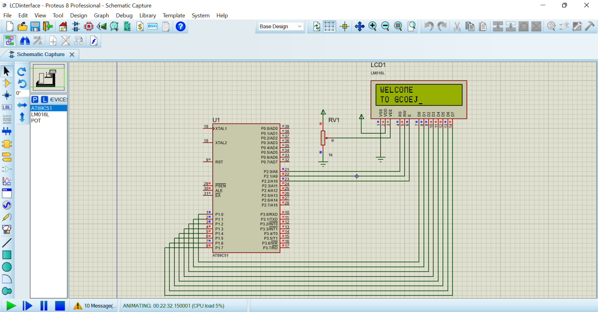
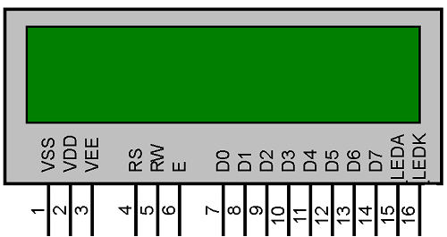

# Practical 07 — 16×2 LCD Interfacing with 8051

> **Aim:** Interface a 16×2 alphanumeric LCD module with the 8051 microcontroller in 8-bit mode and display text across both lines.  
> **Apparatus:** Keil uVision IDE and Proteus.

---

## Code

```asm
ORG 0000H
RS BIT P2.0
RW BIT P2.1
EN BIT P2.2

        MOV A, #38H         ; 8-bit mode, 2 lines, 5x7 font matrix
        ACALL CMD
        MOV A, #0EH         ; Display ON, cursor ON
        ACALL CMD
        MOV A, #01H         ; Clear display screen
        ACALL CMD
        MOV A, #06H         ; Auto-increment cursor right
        ACALL CMD
        MOV A, #80H         ; Move cursor to Line 1, Position 0
        ACALL CMD

        MOV A, #'W'
        ACALL DATA1
        MOV A, #'E'
        ACALL DATA1
        MOV A, #'L'
        ACALL DATA1
        MOV A, #'C'
        ACALL DATA1
        MOV A, #'O'
        ACALL DATA1
        MOV A, #'M'
        ACALL DATA1
        MOV A, #'E'
        ACALL DATA1

        MOV A, #0C0H        ; Move cursor to Line 2, Position 0
        ACALL CMD
        MOV A, #'T'
        ACALL DATA1
        MOV A, #'O'
        ACALL DATA1
        MOV A, #' '
        ACALL DATA1
        MOV A, #'G'
        ACALL DATA1
        MOV A, #'C'
        ACALL DATA1
        MOV A, #'O'
        ACALL DATA1
        MOV A, #'E'
        ACALL DATA1
        MOV A, #'J'
        ACALL DATA1

HERE:   SJMP HERE           ; Hold displayed message

CMD:    ACALL READY         ; Wait until LCD is not busy
        MOV P1, A           ; Put command byte on D0-D7
        CLR RS              ; RS = 0 -> Command register
        CLR RW              ; RW = 0 -> Write
        SETB EN             ; Latch on high-to-low EN pulse
        ACALL DELAY
        CLR EN
        RET

DATA1:  ACALL READY         ; Wait until LCD is not busy
        MOV P1, A           ; Put ASCII character on D0-D7
        SETB RS             ; RS = 1 -> Data register
        CLR RW              ; RW = 0 -> Write
        SETB EN             ; Latch on high-to-low EN pulse
        ACALL DELAY
        CLR EN
        RET

READY:  SETB P1.7           ; Configure P1.7 (D7) as input to read Busy Flag
        CLR RS              ; RS = 0 -> Command/Status register
        SETB RW             ; RW = 1 -> Read
H:      CLR EN
        ACALL DELAY
        SETB EN
        JB P1.7, H          ; Stay in loop while Busy Flag (D7) = 1
        RET

DELAY:  MOV R4, #180        ; Software delay for LCD timing
H1:     MOV R3, #255
H2:     DJNZ R3, H2
        DJNZ R4, H1
        RET
END
```

---

## Circuit Diagram

### Proteus Simulation Circuit



### 16×2 LCD Pinout Reference



---

## Write-Up & Components

### How It Works
The 16×2 LCD (`LM016L` / HD44780-compatible) has two internal registers selected by **`RS`**:
- **`RS = 0` (Command Register):** Receives setup instructions (`38H` 8-bit 2-line mode, `0EH` display & cursor ON, `01H` clear, `06H` cursor increment, `80H` line 1, `C0H` line 2).
- **`RS = 1` (Data Register):** Receives ASCII character bytes to display (`WELCOME` on line 1, `TO GCOEJ` on line 2).

Before every write, `READY` polls the LCD's busy flag on **`D7` (`P1.7`)** with `RS = 0, RW = 1`. Each command or character is latched into the LCD on a **high-to-low pulse** on **`EN` (`P2.2`)**.

### Key Components & Pin Connections

| Component | Proteus Name / Value | Pin Connections |
| :--- | :--- | :--- |
| Microcontroller (`U1`) | `AT89C51` | `P1.0–P1.7` → LCD `D0–D7`; `P2.0` → `RS`, `P2.1` → `RW`, `P2.2` → `E` |
| 16×2 LCD (`LCD1`) | `LM016L` | `VSS` → GND, `VDD` → +5 V, `VEE` → `RV1` wiper |
| Contrast Potentiometer (`RV1`) | `POT` (`1kΩ`) | Between `+5 V` and `GND`; wiper feeds `VEE` (Pin 3) to set display contrast |
