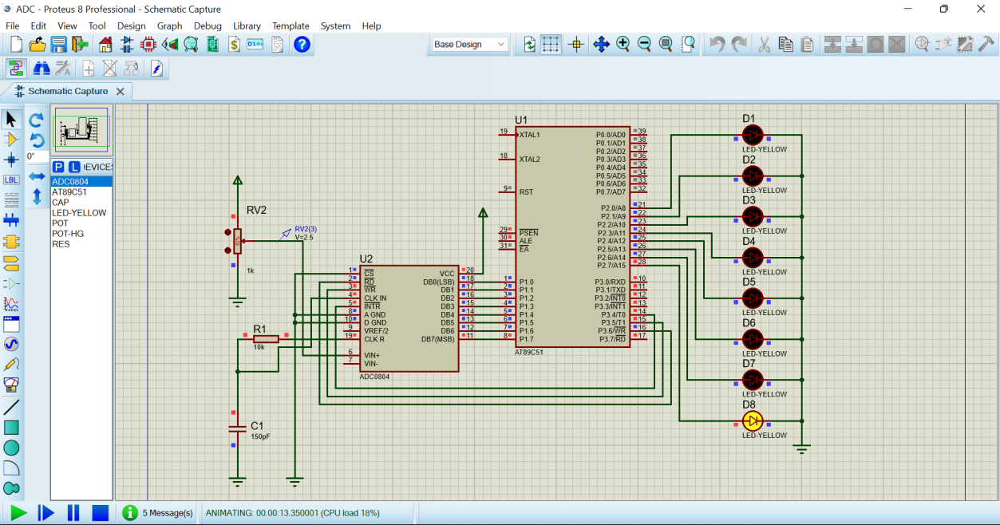

# Practical 08 — ADC0804 Interfacing with 8051

## Code

```asm
ORG 0000H
        MOV P1, #11111111B
        MOV P2, #00000000B
MAIN:   SETB P3.6
        CLR P3.5
        SETB P3.5
H1:     JB P3.4, H1
        CLR P3.6
        ACALL DELAY
        MOV A, P1
        MOV P2, A
        ACALL DELAY
        SETB P3.4
        SJMP MAIN
ORG 210H
DELAY:  MOV R0, #9FH
        MOV R1, #9FH
K:      DJNZ R1, K
K1:     DJNZ R0, K1
        RET
END
```

---

## Circuit Diagram

### Proteus Simulation Circuit



---

## Write-Up

**Aim:** Interface ADC with 8051 microcontroller and verify input and output.

**Apparatus:** Keil uVision IDE and Proteus.

### Theory
`ADC0804` is an 8-bit successive-approximation parallel ADC converting `0–5 V` analog inputs into 8-bit binary data using `WR̄` (start), `INTR̄` (end of conversion), and `RD̄` (read).

### Steps
1. Configure Port 1 (`FFH`) as input from `ADC0804` (`DB0–DB7`) and Port 2 (`00H`) as output to 8 LEDs.
2. Keep `RD̄` (`P3.6`) high and send a low-to-high pulse on `WR̄` (`P3.5`) to start conversion.
3. Poll `INTR̄` (`P3.4`) in loop `H1` until it goes low, indicating conversion is complete.
4. Pull `RD̄` (`P3.6`) low, wait via `DELAY`, read Port 1 into `A`, and output `A` to Port 2 LEDs.
5. Wait, set `P3.4` high, and jump back to `MAIN` for continuous sampling.

### Conclusion
`ADC0804` interfacing with the 8051 microcontroller was verified by varying analog input voltage and observing the corresponding 8-bit binary LED output in Proteus.

---

## Software Operation Guide (Keil uVision & Proteus)

### 1. Keil uVision Setup (Generate `.hex`)
1. Create a folder `C:\MPMC\P08_ADC\`.
2. Open **Keil uVision** → **Project → New uVision Project** → save as `adc.uvproj` inside `C:\MPMC\P08_ADC\`.
3. Select **Atmel / Microchip → `AT89C51`** → **OK** → click **No** for `STARTUP.A51`.
4. Click **File → New**, paste the code above, and save as `adc.asm` in the same folder.
5. Expand **Target 1** → right-click **Source Group 1 → Add Existing Files to Group 'Source Group 1'** → set **Files of type** to **`Asm Source file (*.s*; *.src; *.a*)`** → add `adc.asm` → **Close**.
6. Right-click **Target 1 → Options for Target 'Target 1' → Output** tab → tick **Create HEX File** → **OK**.
7. Press **`F7`** (Build) → confirm `0 Error(s), 0 Warning(s)` and `Objects\adc.hex` created.

### 2. Proteus 8 Professional Setup (Components & Wiring)
1. Create a new Proteus schematic project named `ADC`.
2. Pick components using these exact sections and keywords:

   | Search Section | Exact Keyword | Value / Notes |
   | :--- | :--- | :--- |
   | **Component Mode (`P`)** | `AT89C51` | Microcontroller (`U1`) |
   | **Component Mode (`P`)** | `ADC0804` | 8-bit parallel ADC (`U2`) |
   | **Component Mode (`P`)** | `POT-HG` | Active potentiometer (`RV2`, double-click → set `1k`) |
   | **Component Mode (`P`)** | `RES` | Clock resistor `R1` (double-click → set `10k`) |
   | **Component Mode (`P`)** | `CAP` | Clock capacitor `C1` (double-click → set `150pF`) |
   | **Component Mode (`P`)** | `LED-YELLOW` | Place 8 LEDs (`D1–D8`) for 8-bit binary output |
   | **Terminals Mode** *(left toolbar)* | `POWER` | +5 V to `ADC0804` `VCC` (Pin 20) and top of `RV2` |
   | **Terminals Mode** *(left toolbar)* | `GROUND` | Ground to `CS̄`, `A GND`, `D GND`, `VIN-`, `C1`, `RV2` bottom, and all LED cathodes |

3. Wire the circuit:
   - `ADC0804` `DB0–DB7` (Pins 18–11) → `AT89C51` `P1.0–P1.7` (Pins 1–8).
   - `ADC0804` `INTR̄` (Pin 5) → `P3.4` (Pin 14); `WR̄` (Pin 3) → `P3.5` (Pin 15); `RD̄` (Pin 2) → `P3.6` (Pin 16).
   - `R1 (10k)` between `CLK R` (Pin 19) and `CLK IN` (Pin 4); `C1 (150pF)` from `CLK IN` (Pin 4) to `GROUND`.
   - `RV2` wiper → `VIN+` (Pin 6).
   - `AT89C51` `P2.0–P2.7` (Pins 21–28) → `D1–D8` anodes.

### 3. Linking Keil & Proteus
1. Double-click **`U1` (`AT89C51`)** → **Program File** → browse to `C:\MPMC\P08_ADC\Objects\adc.hex` → click **OK**.
2. Click the green **Play** button (bottom-left). Click the red `+` / `-` arrows on `RV2` to vary the input voltage from `0 V` to `5 V` and verify the 8-bit binary count on LEDs `D1–D8` (e.g., `2.5 V` lights MSB `D8`).
