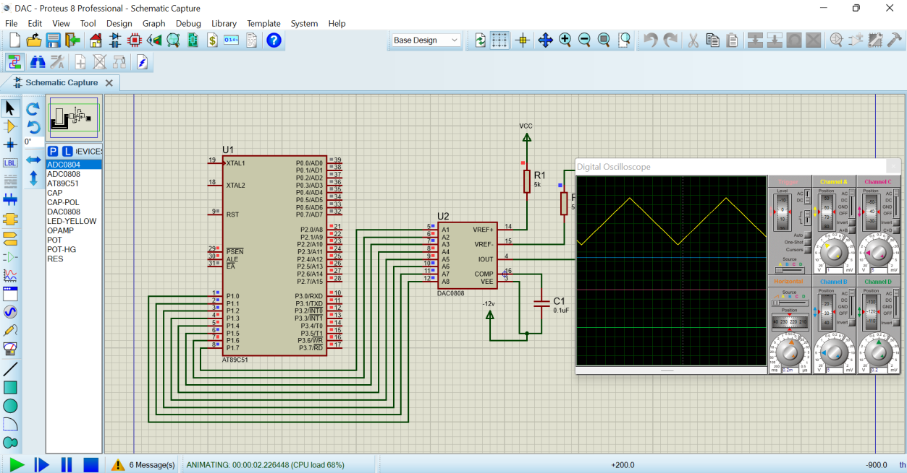
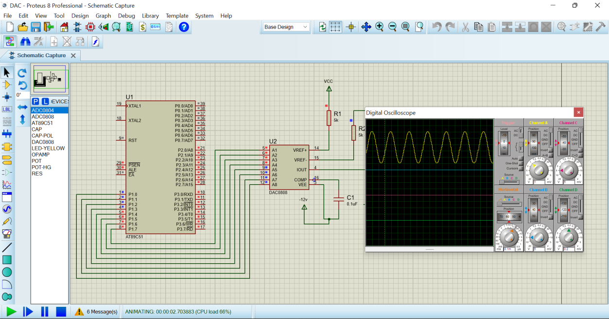

# Practical 09 — DAC0808 Waveform Generation with 8051

## Code

### A. Square Wave

```asm
ORG 0000H
        MOV P1, #00H
AGAIN:  MOV P1, #00H
        ACALL DELAY
        MOV P1, #0FFH
        ACALL DELAY
        SJMP AGAIN
DELAY:  MOV R1, #0FFH
        MOV R2, #0FFH
LOOP1:  DJNZ R2, LOOP1
LOOP2:  DJNZ R1, LOOP2
        RET
END
```

### B. Triangular Wave

```asm
ORG 0000H
        MOV P1, #00H
        MOV A, #00H
INCR:   MOV P1, A
        INC A
        CJNE A, #255, INCR
DECR:   MOV P1, A
        DEC A
        CJNE A, #00, DECR
        SJMP INCR
END
```

### C. Sine Wave

```asm
ORG 0000H
        MOV P1, #00H
LP4:    MOV DPTR, #TABLE
        MOV R2, #24H
BACK4:  CLR A
        MOVC A, @A+DPTR
        MOV P1, A
        INC DPTR
        DJNZ R2, BACK4
        SJMP LP4
TABLE:  DB 128,150,172,193,212,228,240,249,253,255,253,249,240,228,212
        DB 193,172,150,128,105,83,62,43,27,15,6,2,0,2,6,15,27,43,62,83,105
END
```

---

## Circuit Diagram & Waveforms

### Proteus Simulation Circuit


### Reference Schematic & DAC0808 Pinout


### Observed Proteus Oscilloscope Waveforms

| Square Wave | Triangular Wave | Sine Wave |
| :---: | :---: | :---: |
|  |  |  |

---

## Write-Up

**Aim:** Interface DAC with 8051 microcontroller and observe Square, Triangular, and Sine waveforms.

**Apparatus:** Keil uVision IDE and Proteus.

### Theory
`DAC0808` uses an 8-bit R-2R ladder to convert Port 1 digital codes (`00H–FFH`) into analog current `IOUT`, buffered to voltage via an inverting op-amp (`Rf = 5 kΩ`).

### Steps
1. **Square Wave:** Send `00H` to `P1`, call `DELAY`, send `FFH` to `P1`, call `DELAY`, and repeat infinitely.
2. **Triangular Wave:** Initialize `A = 00H`, increment `A` to `255` outputting each step to `P1`, then decrement `A` back to `0` and repeat.
3. **Sine Wave:** Load `DPTR` with `TABLE` and `R2 = 24H` (36 points), fetch each byte with `MOVC A, @A+DPTR`, output to `P1`, increment `DPTR`, and loop continuously.

### Conclusion
Square, triangular, and sine waveforms were generated using the 8051 and `DAC0808` and verified on the Keil Logic Analyzer and Proteus Digital Oscilloscope.

---

## Software Operation Guide (Keil uVision & Proteus)

### 1. Keil uVision Setup (Generate `.hex` for Each Waveform)
1. Create a folder per waveform (e.g., `C:\MPMC\P09_DAC_Square\`, `P09_DAC_Tri\`, `P09_DAC_Sine\`).
2. Open **Keil uVision** → **Project → New uVision Project** → save as `DACSQ.uvproj` (or `DACTRI` / `DACSINE`).
3. Select **Atmel / Microchip → `AT89C51`** → **OK** → click **No** for `STARTUP.A51`.
4. Click **File → New**, paste the waveform code, and save as `DACSQ.asm` in the same folder.
5. Expand **Target 1** → right-click **Source Group 1 → Add Existing Files to Group 'Source Group 1'** → set **Files of type** to **`Asm Source file (*.s*; *.src; *.a*)`** → add `DACSQ.asm` → **Close**.
6. Right-click **Target 1 → Options for Target 'Target 1' → Output** tab → tick **Create HEX File** → **OK**.
7. Press **`F7`** (Build) → confirm `0 Error(s), 0 Warning(s)` and `.hex` created inside `Objects\`.
8. *(Optional Keil waveform check)* Press **`Ctrl+F5`** → open **View → Analysis Windows → Logic Analyzer** → click **Setup...** → add signal **`P1`** (Display Type: **Analog**, Min `0`, Max `255`) → press **`F5`** to view the waveform inside Keil.

### 2. Proteus 8 Professional Setup (Components & Wiring)
1. Create a new Proteus schematic project named `DAC`.
2. Pick components using these exact sections and keywords:

   | Search Section | Exact Keyword | Value / Notes |
   | :--- | :--- | :--- |
   | **Component Mode (`P`)** | `AT89C51` | Microcontroller (`U1`) |
   | **Component Mode (`P`)** | `DAC0808` | 8-bit R-2R DAC (`U2`) |
   | **Component Mode (`P`)** | `OPAMP` | Ideal Op-Amp (`U3`, or `LM741`) for I-to-V conversion |
   | **Component Mode (`P`)** | `RES` | Place 3 resistors: `R1`, `R2`, `R3` (double-click each → set `5k`) |
   | **Component Mode (`P`)** | `CAP` | Compensation capacitor `C1` (double-click → set `0.1uF`) |
   | **Terminals Mode** *(left toolbar)* | `POWER` | Place two: one labeled `VCC` (+5 V to `R1`), one double-clicked and set String = `-12V` (to `VEE` Pin 3) |
   | **Terminals Mode** *(left toolbar)* | `GROUND` | Ground for `R2` top and `OPAMP` non-inverting (`+`) input |
   | **Virtual Instruments Mode** *(oscilloscope icon, left toolbar)* | `OSCILLOSCOPE` | Digital Oscilloscope — connect op-amp output to Channel `A` |

3. Wire the circuit:
   - `AT89C51` `P1.0–P1.7` (Pins 1–8) → `DAC0808` `A8–A1` (Pins 12 down to 5, where `P1.7` = MSB `A1` Pin 5 and `P1.0` = LSB `A8` Pin 12).
   - `VREF+` (Pin 14) → `R1 (5k)` → `VCC`; `VREF-` (Pin 15) → `R2 (5k)` → `GROUND`.
   - `C1 (0.1uF)` between `COMP` (Pin 16) and `VEE` (Pin 3, `-12V`).
   - `IOUT` (Pin 4) → `OPAMP` inverting (`-`) input; `R3 (5k)` feedback from `OPAMP` output to inverting (`-`) input; `OPAMP` output → Oscilloscope Channel **`A`**.

### 3. Linking Keil & Proteus
1. Double-click **`U1` (`AT89C51`)** → **Program File** → select `Objects\DACSQ.hex` (swap with `DACTRI.hex` or `DACSINE.hex` for the other waves) → click **OK**.
2. Click the green **Play** button (bottom-left). If the Digital Oscilloscope window does not pop up automatically, open **Debug → Digital Oscilloscope**. Adjust Channel A `V/Div` and Horizontal `Time/Div` knobs to view the waveform clearly.
