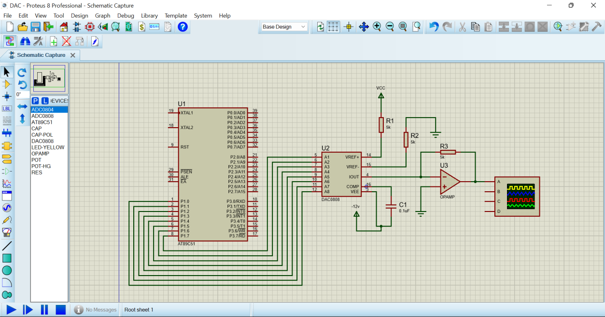
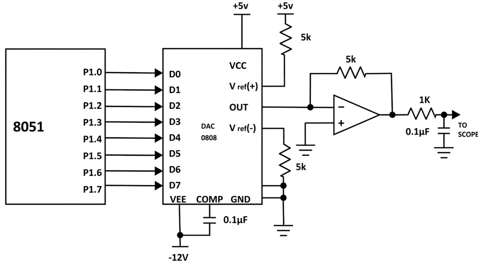
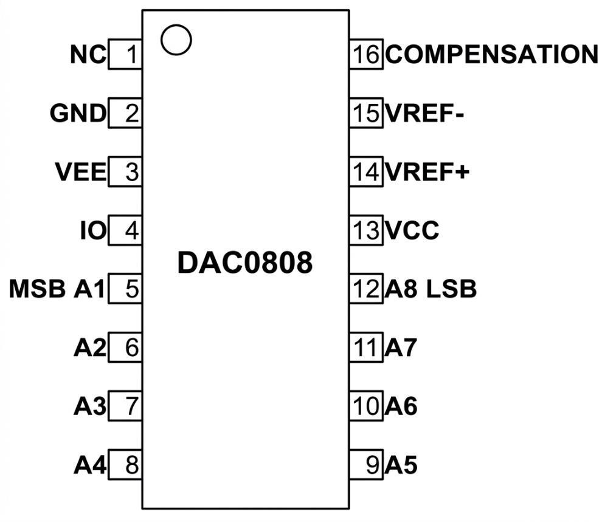
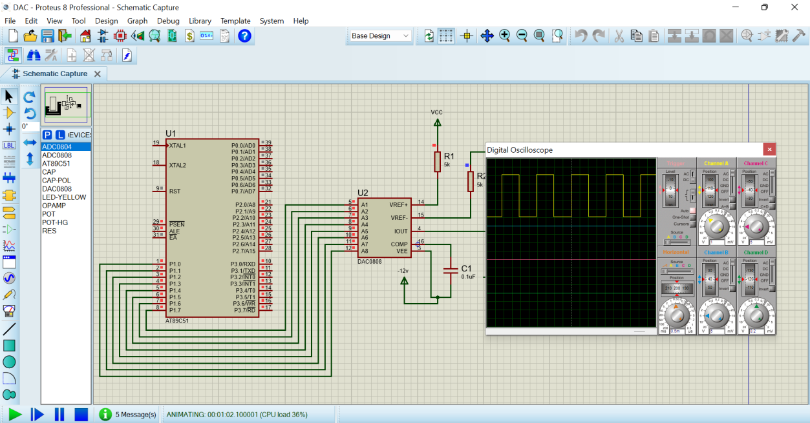

# Practical 09 — DAC0808 Waveform Generation with 8051

> **Aim:** Interface an 8-bit DAC (`DAC0808`) with the 8051 microcontroller and generate **square**, **triangular**, and **sine** waveforms.  
> **Apparatus:** Keil uVision IDE and Proteus.

---

## Code

### A. Square Wave Generation

```asm
ORG 0000H
        MOV P1, #00H
AGAIN:  MOV P1, #00H        ; Output minimum level (00H)
        ACALL DELAY
        MOV P1, #0FFH       ; Output maximum level (FFH)
        ACALL DELAY
        SJMP AGAIN

DELAY:  MOV R1, #0FFH
        MOV R2, #0FFH
LOOP1:  DJNZ R2, LOOP1
LOOP2:  DJNZ R1, LOOP2
        RET
END
```

### B. Triangular Wave Generation

```asm
ORG 0000H
        MOV P1, #00H
        MOV A, #00H
INCR:   MOV P1, A           ; Ramp output UP (00H -> FFH)
        INC A
        CJNE A, #255, INCR
DECR:   MOV P1, A           ; Ramp output DOWN (FFH -> 00H)
        DEC A
        CJNE A, #00, DECR
        SJMP INCR
END
```

### C. Sine Wave Generation (36-Point Lookup Table)

```asm
ORG 0000H
        MOV P1, #00H
LP4:    MOV DPTR, #TABLE    ; Point DPTR to start of sine lookup table
        MOV R2, #24H        ; 24H = 36 samples per full cycle (10 deg step)
BACK4:  CLR A
        MOVC A, @A+DPTR     ; Fetch next sine sample from code memory
        MOV P1, A           ; Send sample to DAC0808 via Port 1
        INC DPTR
        DJNZ R2, BACK4
        SJMP LP4            ; Repeat continuously

TABLE:  DB 128,150,172,193,212,228,240,249,253,255,253,249,240,228,212
        DB 193,172,150,128,105,83,62,43,27,15,6,2,0,2,6,15,27,43,62,83,105
END
```

---

## Circuit Diagram & Waveforms

### Proteus Simulation Circuit



### Reference Schematic & DAC0808 Pinout





### Observed Proteus Oscilloscope Waveforms

| Square Wave | Triangular Wave | Sine Wave |
| :---: | :---: | :---: |
|  |  |  |

---

## Write-Up & Components

### How It Works
**`DAC0808`** is an 8-bit R-2R ladder DAC that maps the 8-bit binary code on **Port 1** (`00H–FFH`, 256 discrete levels) to an analog output current `I_out` (Pin 4). Because load resistance would distort a simple resistor-to-voltage conversion, an **inverting op-amp (`U3`, e.g., LM741)** with feedback resistor `R3 = 5 kΩ` converts `I_out` cleanly into a buffered analog voltage viewed on the Proteus Digital Oscilloscope:
- **Square Wave:** Alternates Port 1 between `00H` and `FFH` with equal delays.
- **Triangular Wave:** Linearly counts up (`0 → 255`) and back down (`255 → 0`).
- **Sine Wave:** Streams 36 precomputed values from `TABLE` using `128 + 127·sin(θ)` in 10° steps.

### Key Components & Pin Connections

| Component | Proteus Name / Value | Role & Connections |
| :--- | :--- | :--- |
| Microcontroller (`U1`) | `AT89C51` | `P1.7` (MSB) → `A1` (Pin 5) down to `P1.0` (LSB) → `A8` (Pin 12) |
| 8-Bit DAC (`U2`) | `DAC0808` | `VCC` (+5 V), `VEE` (-12 V), `VREF+` via `R1 = 5 kΩ` to +5 V, `VREF-` via `R2 = 5 kΩ` to GND |
| Compensation Cap (`C1`) | `0.1 µF` | Between `COMP` (Pin 16) and `VEE` (-12 V) for stability |
| I-to-V Converter (`U3`, `R3`) | `OPAMP` (741), `5 kΩ` | Converts DAC output current (`IOUT`, Pin 4) to analog voltage for oscilloscope Channel A |
