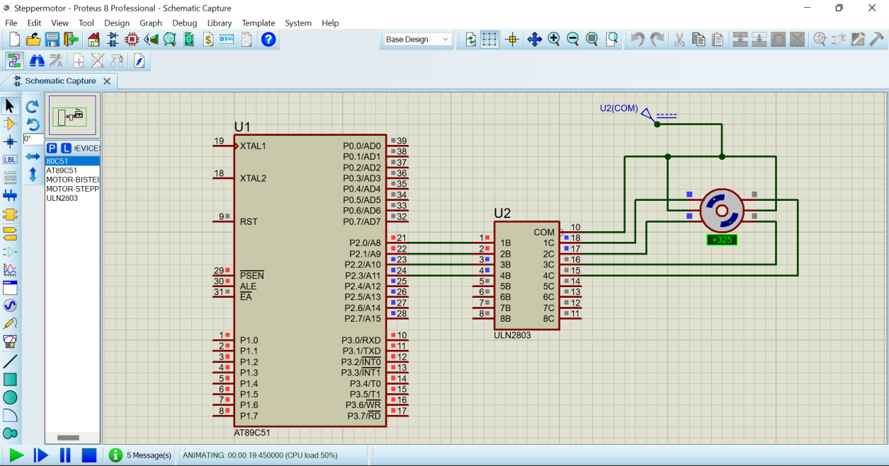
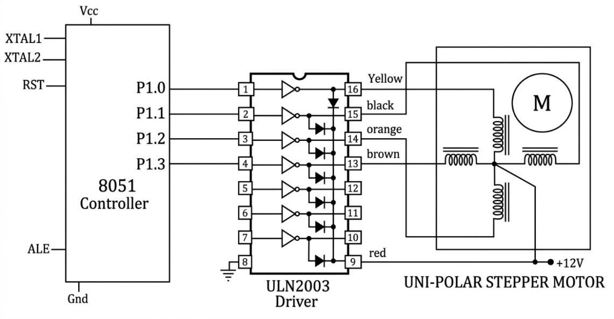

# Practical 10 — Stepper Motor Interfacing with 8051

> **Aim:** Interface a 4-phase unipolar stepper motor with the 8051 microcontroller using a Darlington driver IC and rotate it continuously in fixed steps.  
> **Apparatus:** Keil uVision IDE and Proteus.

---

## Code

```asm
ORG 0000H
UP:     MOV P2, #09H        ; Step 1: Energize coils (1001b)
        ACALL DELAY
        MOV P2, #0CH        ; Step 2: Energize coils (1100b)
        ACALL DELAY
        MOV P2, #06H        ; Step 3: Energize coils (0110b)
        ACALL DELAY
        MOV P2, #03H        ; Step 4: Energize coils (0011b)
        ACALL DELAY
        SJMP UP             ; Repeat continuously (reverse sequence for CCW)

DELAY:  MOV R4, #0FFH
        MOV R3, #0FFH
H1:     DJNZ R3, H1
H2:     DJNZ R4, H2
        RET
END
```

---

## Circuit Diagram

### Proteus Simulation Circuit



### Unipolar Stepper Driver Reference Schematic



*(Note: The reference schematic illustrates `ULN2003` on `P1.0–P1.3`; the Proteus circuit and program above drive `ULN2803` from **`P2.0–P2.3`**.)*

---

## Write-Up & Components

### How It Works
A **4-phase unipolar stepper motor** rotates in discrete angular increments (e.g., `1.8°/step` for a 200-step motor) whenever its four stator windings are energized in sequence. Because a stepper coil draws ~400 mA—far beyond an 8051 pin's limit—a **Darlington driver IC (`ULN2803` / `ULN2003`)** supplies up to 500 mA per channel and includes internal freewheeling diodes to absorb inductive back EMF.

Sending the full-step (two-phase-on) excitation sequence **`09H → 0CH → 06H → 03H`** to `P2.0–P2.3` rotates the shaft clockwise; reversing the sequence (`03H → 06H → 0CH → 09H`) reverses direction, and adjusting `DELAY` controls rotation speed.

### Key Components & Pin Connections

| Component | Proteus Name / Value | Role & Connections |
| :--- | :--- | :--- |
| Microcontroller (`U1`) | `AT89C51` | Outputs 4-bit step sequence on `P2.0–P2.3` (Pins 21–24) |
| Motor Driver IC (`U2`) | `ULN2803` *(or `ULN2003`)* | `1B–4B` ← `P2.0–P2.3`; `1C–4C` → stepper coils; `COM` (Pin 10) → motor supply (`+12 V` / power) |
| Stepper Motor | `MOTOR-STEPPER` | Unipolar 4-winding stepper motor; center taps tied to `COM` / supply |
